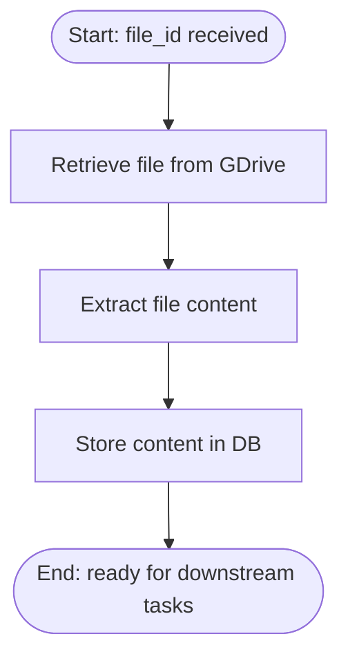

Table of Content

- Intro and Objective

- Project Setup and Installation

- Setting up Google Drive and Testing

- Setting up redis queue 

- Creating a FastAPI App to encompass everything

## Intro and Objectives

For most production grade systems, the difference between frequent server overload (or high latency) and seamless flow is a server that can handle multiple high-memory processes at a time.

A common technique for achieving this seamlessness is through the use of a job queue to handle long-running or resource-intensive requests.

A typical job queue consists of: a producer, message broker and a consumer.

- The producer is responsible for creating a task

- The consumer performs an action on the task

- And the message broker routes created tasks to the right consumer 

In this tutorial you will learn how to build a job queue, using Redis Queue (RQ), that processes documents in google drive and stores them in a vector database for downstream tasks.

## Pre-requisites

- python 3.11+ installed
- docker+redis installed (*use wsl if on windows*)
- basic knowledge of python
- a google chrome and cloud account

## Project Setup and Installation

1. Create your project folder i.e. `gdrive-data-pipeline`.

2. In your project folder, create a file named `requirements.txt` and place the following packages:
   
   ```
   #Gdrive Libraries
   google-api-python-client 
   google-auth-httplib2 
   google-auth-oauthlib
   
   # AI Services
   langchain
   langchain-community
   langchain-text-splitters
   langchain-huggingface
   pymupdf4llm
   sentence-transformers   
   langchain-chroma
   
   # Server & Framework
   redis
   rq
   rq-dashboard
   
   fastapi
   uvicorn
   python-dotenv
   ```

3. In your terminal, create a virtual environment, activate it, then install the python packages. 

```
> python -m venv env 
> source env/bin/activate
> pip install -r requirements.txt
```

## Connecting to Google Drive API

For this project, we will need to gain programmatic access to our google drive. To do so, follow these steps.

#### Step 1: Create OAuth credentials in Google Cloud Console

1. Go to the Google Cloud Console and select or create a project.

2. Enable the **Google Drive API** for that project, under "APIs & Services" → "Library".

3. Then go to "Credentials" → **Create Credentials** → **OAuth client ID**. 

4. When prompted for an application type, choose **Desktop app** . 

5. Download the generated JSON file and save it in your project folder as `credentials.json`.

*Note: If you have not configured the Oauth consent screen in previously, you will need to do so. Ensure to set the app type to `external` and add your email as a test user. The email should be the one linked to your default chrome browser page. This helps prevent access errors in the initial browser pop-up authentication page.*

#### Step 2: Write the Authentication logic

In your project folder, create a file named `gdrive.py`, and place this function.

    from google.auth.transport.requests import Request
    from google.oauth2.credentials import Credentials
    from google_auth_oauthlib.flow import InstalledAppFlow
    from googleapiclient.discovery import build
    import os
    
    SCOPES = ["https://www.googleapis.com/auth/drive.readonly"]
    
    def get_drive_service():
        creds = None
    
        # 1. Reuse a saved token from a previous run, if one exists
        if os.path.exists("token.json"):
            creds = Credentials.from_authorized_user_file("token.json", SCOPES)
    
        # 2. If there's no valid token yet, get one
        if not creds or not creds.valid:
            if creds and creds.expired and creds.refresh_token:
                creds.refresh(Request())
            else:
                flow = InstalledAppFlow.from_client_secrets_file(
                    "credentials.json", SCOPES
                )
                creds = flow.run_local_server(port=0)
    
            # 3. Cache the token so future runs skip the browser prompt
            with open("token.json", "w") as token:
                token.write(creds.to_json())
    
        # 4. Build the drive service
        return build("drive", "v3", credentials=creds)

Here, we create a reusable function `get_drive_service`that allows us to access our google drive files in our project. In the initial run the tokens are cached in`tokens.json` for future runs.

#### Step 3: Testing the Google Drive API

 In the same directory, create a file named `main.py`. Then add the below script code

```
from .gdrive import get_drive_service

if __name__ == "__main__":
    service = get_drive_service()

    # Call the service build and retrieve 5 files while excluding any that is a folder
    files = service.files().list(
            pageSize=5,
            q=f"mimeType != '{FOLDER_MIME_TYPE}' and trashed = false",
            fields="files(id, name, mimeType)",
    ).execute().get("files", [])

    print(files)
```

To view the results of the printed files, run the following command with the terminal set to the project directory and env activated:  

```
> python main.py
```

*If you are running it for the first time, you should be prompted by your browser to complete an authentication step in your default browser. Thereafter it is cached and you won't need to do so afterwards.*

## Setting up the job queue

Now that we have completed setting up google drive programmarticaly, we now move on to the job queue. For this, we'll be using the python framework redis queue.

Redis Queue (RQ) is a Python library built on top of redis. Where Redis serves as a message broker for the enqueued jobs and as temporary storage for job results. The core concepts associated with RQ are:

- Jobs: tasks in a system pushed into a queue for asynchronous processing. In our case, they represent a python function. 

- Queues: persistent stores that utilize redis data structures to hold enqueued jobs until they are consumed by a worker.

- Workers:  independent system procesess that run the logic in jobs that have been enqueued. They run these processes until they complete, reach a time limit or crash.

The nature of our system will determine what types of jobs to be added to the queue, and in what order. In our case, our aim is to:

- get a PDF document from gdrive

- extract it's content

- and store the content in a persistent vector db for downstream tasks



*In this tutorial we will deal only with PDF documents but you are free to extend this by including the document types you want in the list of allowed file types. Reference them at https://developers.google.com/workspace/drive/api/guides/mime-types* 

#### Creating the job queue

First, ensure that redis is activated, you can do this by typing `redis-cli ping` in the CLI, you should receive `PONG` as a response. If you do not, this means redis is either not activated or not installed on your system. 

If redis is not installed on your system, follow this official guide to do so

After ascertaining that redis is up and running, create `tasks.py` and place the following content inside:

```
import time

from redis import Redis
from rq import Queue

RESULT_TTL = 3600  # keeps job results around for an hour
redis = Redis(host="localhost", port=6379)

retrieve_file_q = Queue("retrieve-file", connection=redis)
read_document_q = Queue("document-reading", connection=redis)
store_q = Queue("store", connection=redis)


def start_job_pipeline(file_id):
    """Enqueues all Jobs and returns their ids."""
    job_1 = retrieve_file_q.enqueue(retrieve_document, file_id, result_ttl=RESULT_TTL)
    job_2 = read_document_q.enqueue(
        read_document, file_id, depends_on=job_1, result_ttl=RESULT_TTL
    )
    job_3 = store_q.enqueue(
        store_document, file_id, depends_on=job_2, result_ttl=RESULT_TTL
    )
    return {"ids": [{"job_1": job_1.id}, {"job_2": job_2.id}, {"job_3": job_3.id}]}


def retrieve_document(file_id):
    """Extracts the content of a google drive document."""
    print(f"Started retrieving document with id {file_id}")
    time.sleep(10)
    print(f"Finished retrieving document with id {file_id}")


def read_document(file_id):
    """
    Translates the byte contents of a google drive document
    to python objects.
    """
    print(f"Started reading document bytes with id {file_id}")
    time.sleep(20)
    print(f"Finished reading document bytes with id {file_id}")


def store_document(file_id):
    """Persists the object representation of the google drive document
    into a db"""
    print(f"Starting ingestion of documents with id {file_id}")
    time.sleep(5)
    print(f"Finished ingestion of documents with id {file_id}")
```

We begin with creating a reusable redis connection which becomes the foundation for our Queue instances to persist incoming jobs. 

Then we create a sequential job pipeline; `start_job_pipeline` that is responsible for creating all the jobs required for a single document processing just as mentioned in the description above.

Then in the same`main.py`, update it to add the`start_job_pipeline`function:

```
from gdrive import get_drive_service
from tasks import start_job_pipeline

if __name__ == "__main__":
    service = get_drive_service()

    files = (
        service.files()
        .list(
            pageSize=5,
            q="mimeType = 'application/pdf' and trashed = false",
            fields="files(id, name)",
        )
        .execute()
        .get("files", [])
    )

    start_job_pipeline(files[0]["id"])

```

To then interact with the queue, type in your terminal; 

```
> python main.py
> rq worker -u redis://localhost:6379 document-reading store retrieve-file
```

You should see an output similar to this:

*Note if you are using a windows based terminal you will most likely receive an error because redis is not operational in windows. To fix this, open the project's directory in wsl terminal instead, reinstall the vitrual enviroment in it and then rerun the command*

#### Completing the job queue

Now that we have a high-level understanding of how the queue works, let's go more into the details.

##### Document Retrieval

First job is `retrieve_document`. 

```
#....other imports
import io
from gdrive import get_drive_service

def retrieve_document(file_id):
    """Extracts the content of a google drive document."""
    print(f"Started retrieving document with id {file_id}")
    service = get_drive_service()
    pdf_byte_content = service.files().get_media(
        q="mimeType = 'application/pdf' and trashed = false",
        fields="files(id, name, mimeType)",
    ).execute()
    print(f"Finished retrieving document with id {file_id}")
    return io.BytesIO(pdf_byte_content)
```

We use the `get_drive_service` defined earlier to create a service instance which we use to fetch PDF documents as bytes. If the file is not one of these, an error is raised for the file.

##### Document Reading

Next is the job responsible for file extraction. Before moving on to the main logic, create a file named `helper.py` and place in the below.

```
from langchain_core.documents import Document
from langchain_text_splitters import (
    MarkdownHeaderTextSplitter,
    RecursiveCharacterTextSplitter,
)
from typing import List

def extract_chunks(documents: List[Document]) -> List[Document]:
    markdown_splitter = MarkdownHeaderTextSplitter(
        headers_to_split_on=[
            ("#", "h1"),
            ("##", "h2"),
            ("###", "h3"),
        ],
        strip_headers=False,
    )

    recursive_splitter = RecursiveCharacterTextSplitter(
        chunk_size=1000,
        chunk_overlap=150,
    )

    chunks = []

    for doc in documents:
        structural_chunks = markdown_splitter.split_text(doc.page_content)
        for chunk in structural_chunks:
            chunk.metadata = {**doc.metadata, **chunk.metadata}
        final_chunks = recursive_splitter.split_documents(structural_chunks)
        chunks.extend(final_chunks)
    return chunks


def convert_to_langchain_docs(pages) -> List[Document]:
    documents = []

    # Extract the metadata, including page, title and other metadata provided
    for page in pages:
        metadata = page["metadata"].copy()

        metadata["toc_items"] = page.get("toc_items", [])
        metadata["images"] = page.get("images", [])
        metadata["tables"] = page.get("tables", [])
        metadata["graphics"] = page.get("graphics", [])

        documents.append(
            Document(
                page_content=page["text"],
                metadata=metadata,
            )
        )
    return documents
```

The first function; `extract_chunks` is used to convert our pdf reader object into an enriched chunk by extracting text content and metadata for each subject, and then using langchain splitters to chunk the document, and add the useful metadata.

On to the main job logic.

```
#..previous imports

import pymupdf
import pymupdf4llm
from redis import Redis
from rq import Queue, get_current_job
from helper import convert_to_langchain_docs, extract_chunks

def read_document():
    """
    Translates the byte contents of a google drive document
    """
    print(f"Started reading document bytes with id {file_id}")

    job = get_current_job()
    file_bytes = job.dependency.result

    file = pymupdf.open(stream=file_bytes, filetype="pdf")

    pages = pymupdf4llm.to_markdown(
        file,
        page_chunks=True,
        write_images=True,
        image_path="./images",
    )

    docs = convert_to_langchain_docs(pages)
    chunked_docs = convert_to_chunks(docs)

    print(f"Finished reading document bytes with id {file_id}")
    return chunked_docs
```

In this function, we use pymupdf4llm to extract the pdf content and convert it into sizable chunks using langchain text_splitter.

##### Persistence

And finally persistence in the vector store

```
from langchain_qdrant import QdrantVectorStore
from qdrant_client import QdrantClient
from langchain_huggingface import HuggingFaceEmbeddings

def store_document(file_id):
    """Persists the object representation of the google drive document
    into a db"""
    print(f"Starting ingestion of documents with id {file_id}")

    job = get_current_job()
    file_bytes = job.dependencies.result

    embeddings = HuggingFaceEmbeddings(
    model_name="sentence-transformers/all-MiniLM-L6-v2",
    model_kwargs={'device': 'cpu'},      # Change to 'cuda' or 'mps' if you have a GPU
    encode_kwargs={'normalize_embeddings': True} # Normalizes vectors for cosine similarity
)

    vector_store = Chroma(
    collection_name="example_collection",
    embedding_function=embeddings,
    persist_directory="./chroma_langchain_db",
)
    vector_store.add_documents(chunks)
    print(f"Finished ingestion of documents with id {file_id}")
```

Now that we have persisted this document we have now completed our major goal. We can then test this by running our `main.py` script once again and observing our chroma db in the cli

```

```

## Creating a FastAPI App to encompass everything

Now that we have completed our job pipeline, we can exercise this into a dashboard . To achieve this we'll create an interactive UI that allows you to search through your documents, select for processing and then search through the documents using bm25. 

In the same `main.py` file, add the below Fastapi routes

```
from gtest import FOLDER_MIME_TYPE, get_drive_service
from tasks import start_job
from fastapi import FastAPI, Depends
from typing import Any

app = FastAPI()

@app.get("/api/list_folders")
def list_folders(number: int = 20, service: Any = Depends(get_drive_service)):
    items = (
        service.files()
        .list(
            pageSize=number,
            q=f"mimeType = '{FOLDER_MIME_TYPE}' and trashed = false",
            fields="files(id, name, mimeType)",
        )
        .execute()
        .get("files", [])
    )
    return {"folders": items}


@app.get("/api/list_files")
def list_files(number: int = 20, service: Any = Depends(get_drive_service)):
    items = (
        service.files()
        .list(
            pageSize=number,
            q=f"(mimeType != '{FOLDER_MIME_TYPE}' and "application/pdf") and trashed = false",
            fields="files(id, name, mimeType)",
        )
        .execute()
        .get("files", [])
    )
    return {"files": items}


@app.get("/api/list_folder_contents/{folder_id}")
def list_folder_contents(
    folder_id: str, number: int = 20, service: Any = Depends(get_drive_service)
):
    items = (
        service.files()
        .list(
            pageSize=number,
            q=f"'{folder_id}' in parents and trashed = false",
            fields="files(id, name, mimeType)",
        )
        .execute()
        .get("files", [])
    )
    return {"files": items}


@app.post("/api/process-files")
def process_files(files: list[dict]):
    jobs = []
    for file in files:
        jobs = start_job(file.id)
    return jobs    


if __name__ == "__main__":
    service = get_drive_service()
    files = (
        service.files()
        .list(
            pageSize=5,
            q=f"mimeType != '{FOLDER_MIME_TYPE}' and trashed = false",
            fields="files(id, name, mimeType)",
        )
        .execute()
        .get("files", [])
    )
    print(files)

    start_job(files[0]["id"])


@app.get("/api/list_folders")
def list_folders(number: int = 20, service: Any = Depends(get_drive_service)):
    items = (
        service.files()
        .list(
            pageSize=number,
            q=f"mimeType = '{FOLDER_MIME_TYPE}' and trashed = false",
            fields="files(id, name, mimeType)",
        )
        .execute()
        .get("files", [])
    )
    return {"folders": items}


@app.get("/api/list_files")
def list_files(number: int = 20, service: Any = Depends(get_drive_service)):
    items = (
        service.files()
        .list(
            pageSize=number,
            q=f"(mimeType != '{FOLDER_MIME_TYPE}' and "application/pdf") and trashed = false",
            fields="files(id, name, mimeType)",
        )
        .execute()
        .get("files", [])
    )
    return {"files": items}


@app.get("/api/list_folder_contents/{folder_id}")
def list_folder_contents(
    folder_id: str, number: int = 20, service: Any = Depends(get_drive_service)
):
    items = (
        service.files()
        .list(
            pageSize=number,
            q=f"'{folder_id}' in parents and trashed = false",
            fields="files(id, name, mimeType)",
        )
        .execute()
        .get("files", [])
    )
    return {"files": items}


@app.post("/api/process-files")
def process_files(files: list[dict]):
    jobs = []
    for file in files:
        jobs = start_job(file.id)
    return jobs    

if __name__ == "__main__":
    service = get_drive_service()
    files = (
        service.files()
        .list(
            pageSize=5,
            q=f"mimeType != '{FOLDER_MIME_TYPE}' and trashed = false",
            fields="files(id, name, mimeType)",
        )
        .execute()
        .get("files", [])
    )
    print(files)

    start_job(files[0]["id"])
```

Then create a static folder and  place the following html code.

### Bonus: Monitoring with RQ-dashboard

RQ also comes with a tool to help visually display of the tasks and queues that have been invoked. To access this, go to your terminal in your project folder and simply type in the following command:

```
rq-dashboard
```

This should produce a message similar to this:


And by visiting the provided url in your web browser, in this case: http://localhost:9181/, you shoul see something similar to the below

